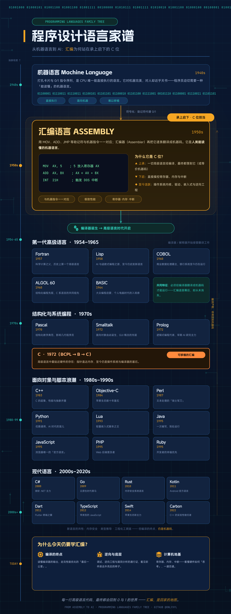
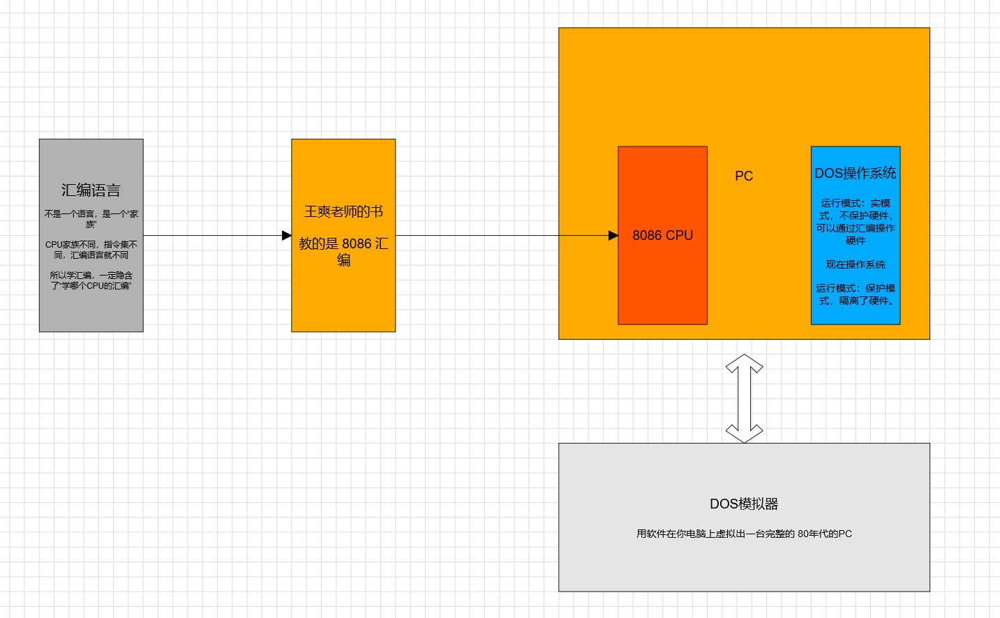
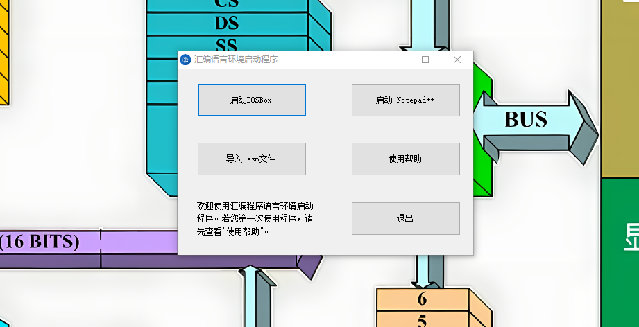
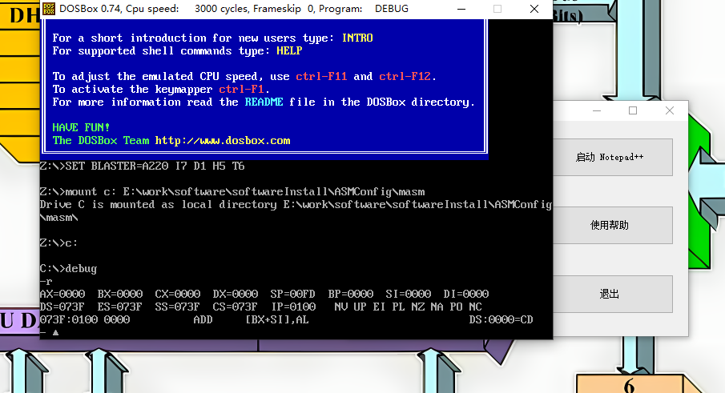

# 01 · 汇编语言

> 教材：王爽《汇编语言（第 4 版）》
> 工具：DOSBox + debug（DOS 自带调试工具）、emu8086（图形化模拟器，备选）

本阶段逐章学习王爽老师的《汇编语言》，每 1~2 章输出一篇笔记（公众号文章 + B 站实操视频），代码与命令清单按章节存放在本目录。

## 汇编地位

## 概念关系

## 环境说明

1. 安装 [DOSBox](https://pan.baidu.com/s/1VNJwwUB7CfgFjIECYqk70A?pwd=gugd)；
2. 解压文件；
3. 汇编语言环境一键配置
4. 启动 DOSBox，并进入 debug：
   出现一个小横杠 -，就是 debug 的命令提示符了。

出现 `-` 提示符即进入 debug。

## 章节索引

| 目录                                                | 对应章节   | 内容                                                        | 配套文章 / 视频                                                                                                                                                                                                                                                                                                                                                                                                                                                                                                                              |
| --------------------------------------------------- | ---------- | ----------------------------------------------------------- | -------------------------------------------------------------------------------------------------------------------------------------------------------------------------------------------------------------------------------------------------------------------------------------------------------------------------------------------------------------------------------------------------------------------------------------------------------------------------------------------------------------------------------------------- |
| [ch02-first-instruction](./ch02-first-instruction/) | 第 1、2 章 | 机器语言与汇编、三总线、寄存器初识、用 debug 执行第一条指令 | [文章链接](https://mp.weixin.qq.com/s/ThEk8jGqteDfVynITmJaXw)/[视频链接](https://www.bilibili.com/video/BV1eW1FzdE2A/?buvid=HW9D5EF9DE93884FDD0540A2EF05765397EDE&from_spmid=main.h5.share.bOWNM7R.2rv8f5yrj2284tpxmwvlhu7k&is_story_h5=false&mid=%2F9Ql%2Fp8JUv8NCc%2Bfp2VU%2BA%3D%3D&plat_id=116&share_from=ugc&share_medium=harmony&share_plat=harmony&share_session_id=155220b6-c7a9-40e2-afec-f8af6882db34&share_source=WEIXIN&share_tag=s_i&spmid=united.player-video-detail.0.0&timestamp=1795579211&unique_k=daOsuiH&up_id=35187241) |
| ch03-memory-access（待更新）                        | 第 3 章    | 内存访问、`[bx]`、DS 段寄存器、栈与 SS:SP                   | 待更新                                                                                                                                                                                                                                                                                                                                                                                                                                                                                                                                       |

## debug 常用命令速查

| 命令 | 作用                    |
| ---- | ----------------------- |
| `-r` | 查看 / 修改寄存器       |
| `-a` | 写入汇编指令            |
| `-t` | 单步执行一条指令        |
| `-u` | 反汇编（机器码 → 汇编） |
| `-d` | 查看内存内容            |
| `-e` | 修改内存内容            |
| `-q` | 退出 debug              |
